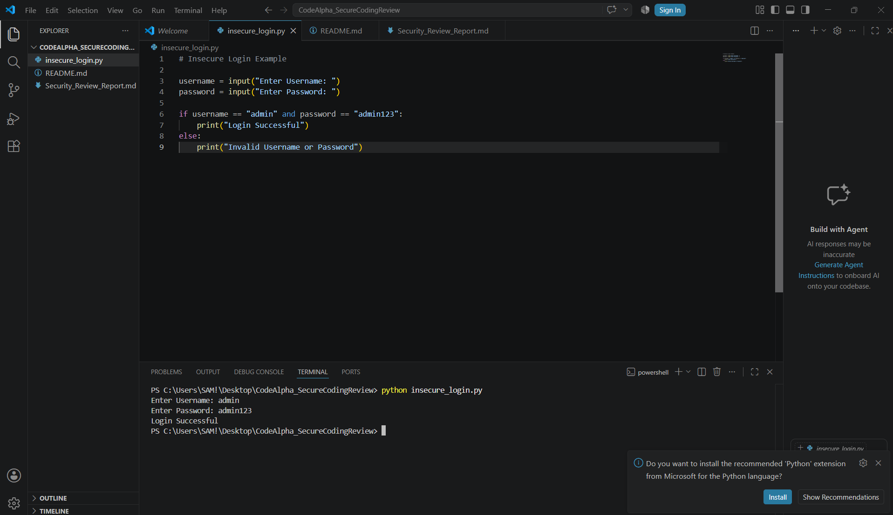

# 🔒 CodeAlpha - Secure Coding Review

## 📖 Overview

This project was completed as part of the **CodeAlpha Cyber Security Internship**.

The objective of this project is to review a Python login application, identify security vulnerabilities, analyze the associated risks, and recommend secure coding practices.

---

## 🎯 Objectives

- Identify common security vulnerabilities.
- Understand secure coding principles.
- Improve application security.
- Recommend industry best practices.

---

## 🛠️ Technologies Used

- Python 3.14
- Visual Studio Code

---

## 📂 Project Structure

```text
CodeAlpha_SecureCodingReview/
│
├── insecure_login.py
├── Security_Review_Report.md
├── README.md
└── code_review_output.png
```

---

## 🔍 Security Issues Identified

- Hardcoded Credentials
- Plain Text Password
- No Password Masking
- No Login Attempt Limit
- No Logging Mechanism

---

## ✅ Recommendations

- Store passwords securely using hashing (bcrypt).
- Use a database instead of hardcoded credentials.
- Hide password input using the `getpass` module.
- Limit failed login attempts.
- Maintain secure logs for login activities.

---

## 📸 Project Output

Upload your screenshot as:

```text
code_review_output.png
```

Then display it using:

markdown



---

## 📚 Learning Outcomes

- Secure Coding Principles
- Password Security
- Authentication Best Practices
- Vulnerability Analysis
- Security Recommendations

---

## 👩‍💻 Author

Madiha Israr Bhatti

BS Information Technology Student

Cyber Security Enthusiast

---

## ⭐ Internship

Project completed for the **CodeAlpha Cyber Security Internship**.
